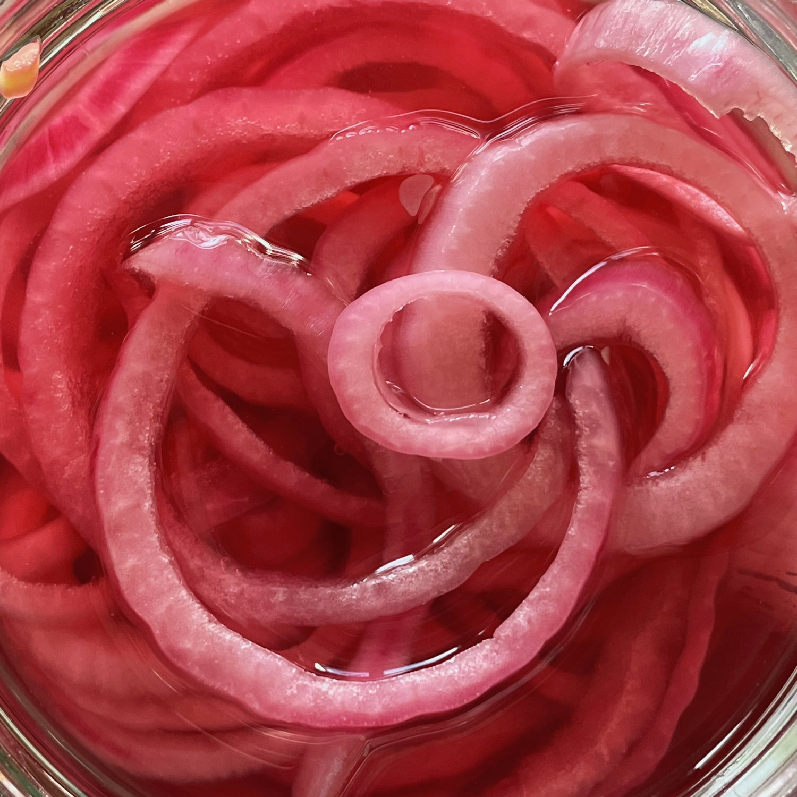

## 🧾 Ingredienti

- 1 Cipolla rossa a fette sottili (Mandolina)
  - Alternativamente Cetriolini interi, Carote Julienne, Cipolline
- 50% Aceto bianco o di mele
- 50% Acqua
- 1 cucchiaio di Zucchero (opzionale)
- Sale

## 👩‍🍳 Preparazione

1. Inserire le verdure in un barattolo
2. Versare la soluzione di acqua, aceto, sale e zucchero fino a coprire le verdure (a freddo per un colore e una consistenza migliori)
3. Lasciare in frigo un giorno prima di consumare

## 💡 Consigli

Si conserva in frigo per massimo 2 settimane
