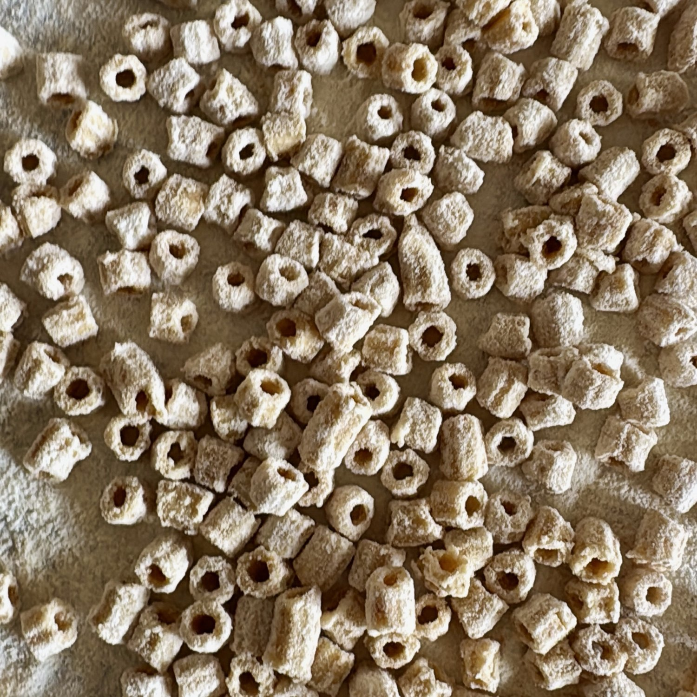
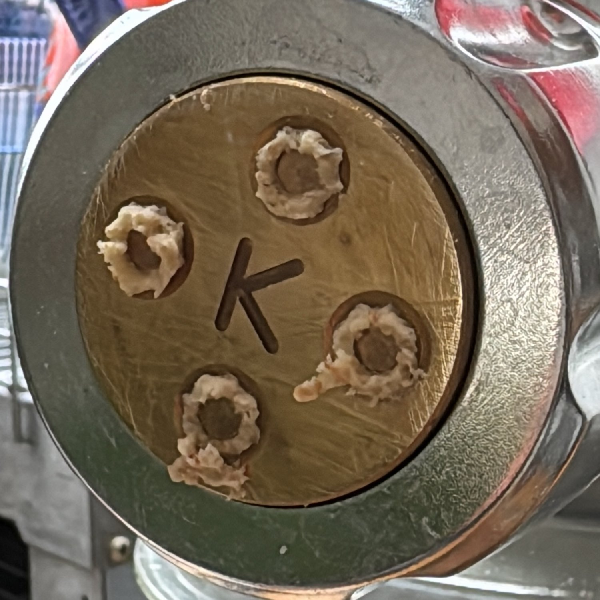

## 🧾 Ingredienti

- 3 Servings
- 1 Uovo + 10 g di acqua (o 65 g di acqua): idratazione 32%
- 200 g Semola rimacinata

## 👩‍🍳 Preparazione

1. Impastare in modo da formare uno sfarinato omogeneo. Velocita' 3 con frusta K, aggiungendo l'acqua a filo partendo dalla sola farina.
2. Passare al torchio
   
3. Cucinare subito (non e' facile seccare la pasta senza che si sfaldi e diventi friabile)
