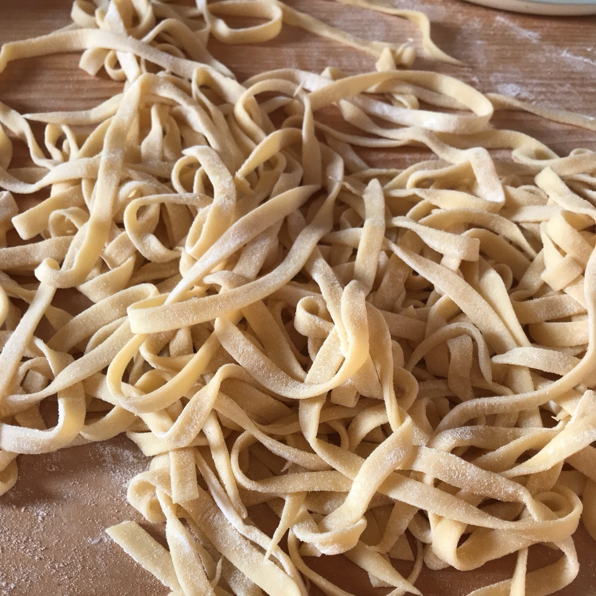

## 🧾 Ingredienti

- Dose per 3 persone
- 2 Uova
- 80 g Farina tipo 0
- 80 g Farina di Semola
- Fino a 40 g di farina in più, se serve

## 👩‍🍳 Preparazione

1. Impastare a mano su una spianatoia, facendo un vulcano di farina con le uova al centro, mescolando inizialmente con la forchetta per dare consistenza alle uova e poi a mano fino a che l'impasto non risulta compatto ed elastico, aggiungendo poco alla volta la farina in più fino alla consistenza desiderata (meglio soda)
2. In alternativa impastare nella planetaria con frusta K
3. Lasciare riposare una mezz'ora coperta prima di procedere a stendere la pasta

## 💡 Consigli

- Usare il penultimo spessore della Imperia per lasagne e ravioli
- Usare l'ultimo o il penultimo spessore della Imperia per tortellini e cappelletti
