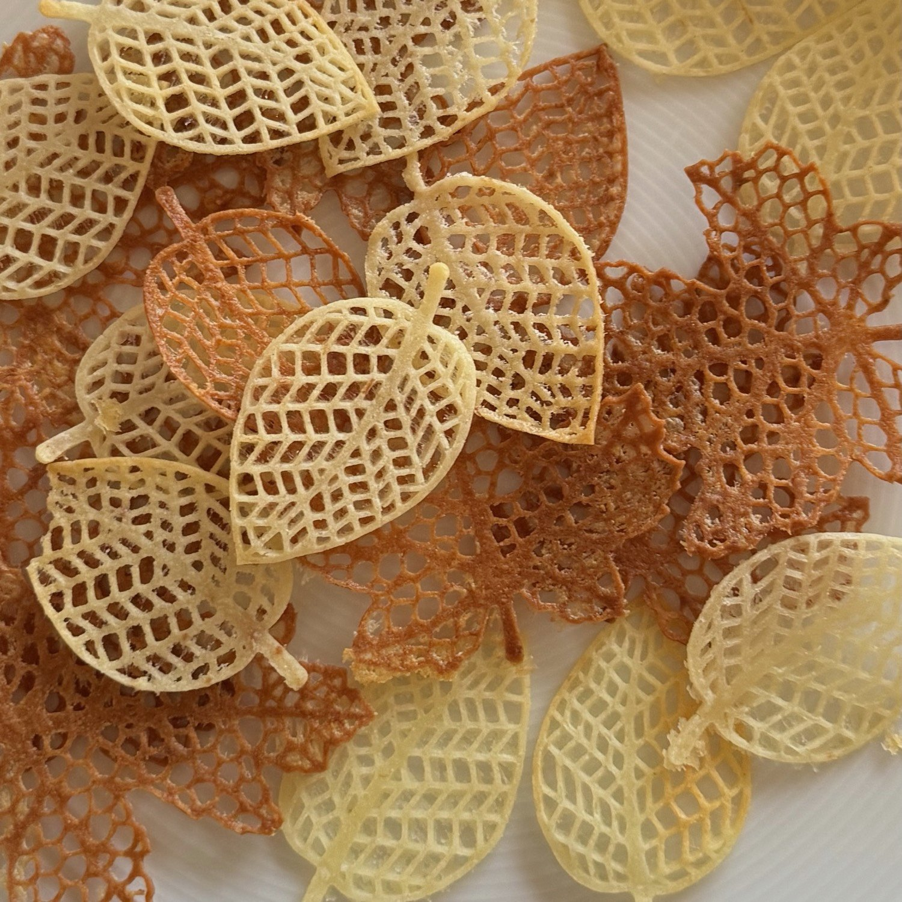
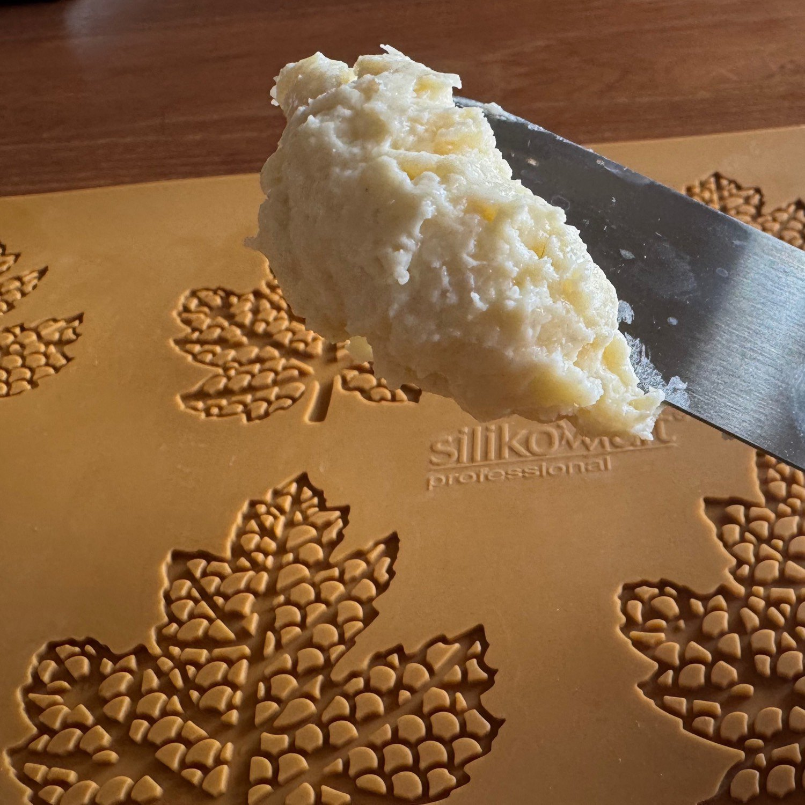

## 🧾 Ingredienti

- 20 g Burro morbido
- 20 g Farina
- 20 g Parmigiano grattugiato finissimo
- 20 g Albume

## 👩‍🍳 Preparazione

1. Lavorare burro e Parmigiano, aggiungere l'albume poco alla volta e infine la farina, fino ad ottenere un impasto omogeneo
2. Stendere sullo stampo in silicone con una spatola e raschiare l'eccesso, in modo che l'impasto resti solo nelle incisioni
3. Infornare a 160º ventilato per circa 6', finché i bordi iniziano a dorare
4. Lasciare intiepidire qualche secondo e staccare delicatamente

