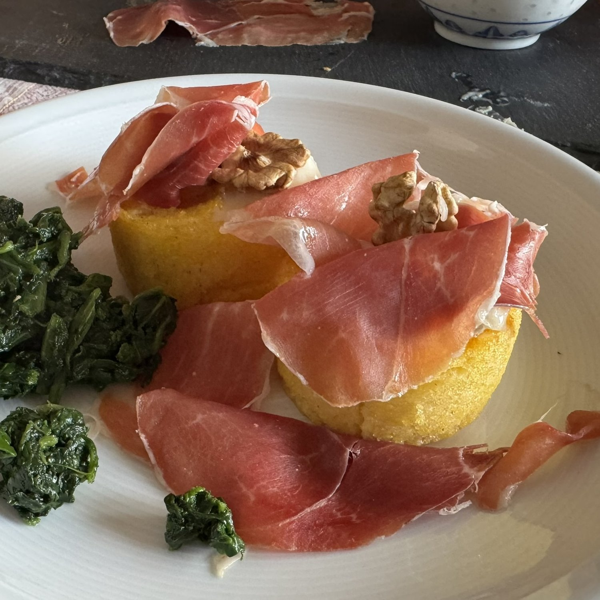
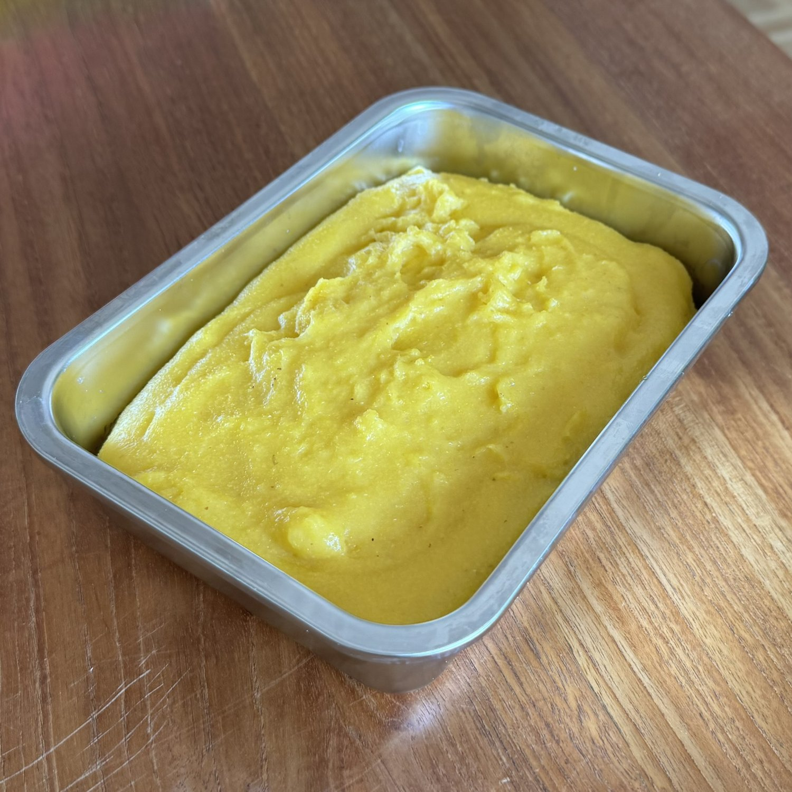

## 🧾 Ingredienti

- Dose per 4 persone
- 250 g di farina di mais per polenta non precotta
- 750–800 ml di acqua
- 5 g di sale
- 1 cucchiaio di olio

## 👩‍🍳 Preparazione

1. Portare a bollore l'acqua con l'olio e il sale: 12 minuti, 100 °C, velocità 1.
2. Inserire la spatola e impostare la velocità 2, quindi aggiungere la farina a pioggia.
3. Cuocere per 40 minuti, 100 °C, velocità 1.

## 💡 Consigli

La polenta può essere consumata subito, servita su una spianatoia. In alternativa, trasferirla in una formina, lasciarla raffreddare e friggerla a fette.

Per ottenere una consistenza più croccante e soda, versarla in uno stampo da plumcake in silicone e cuocerla in forno a 200 °C per 20 minuti.
