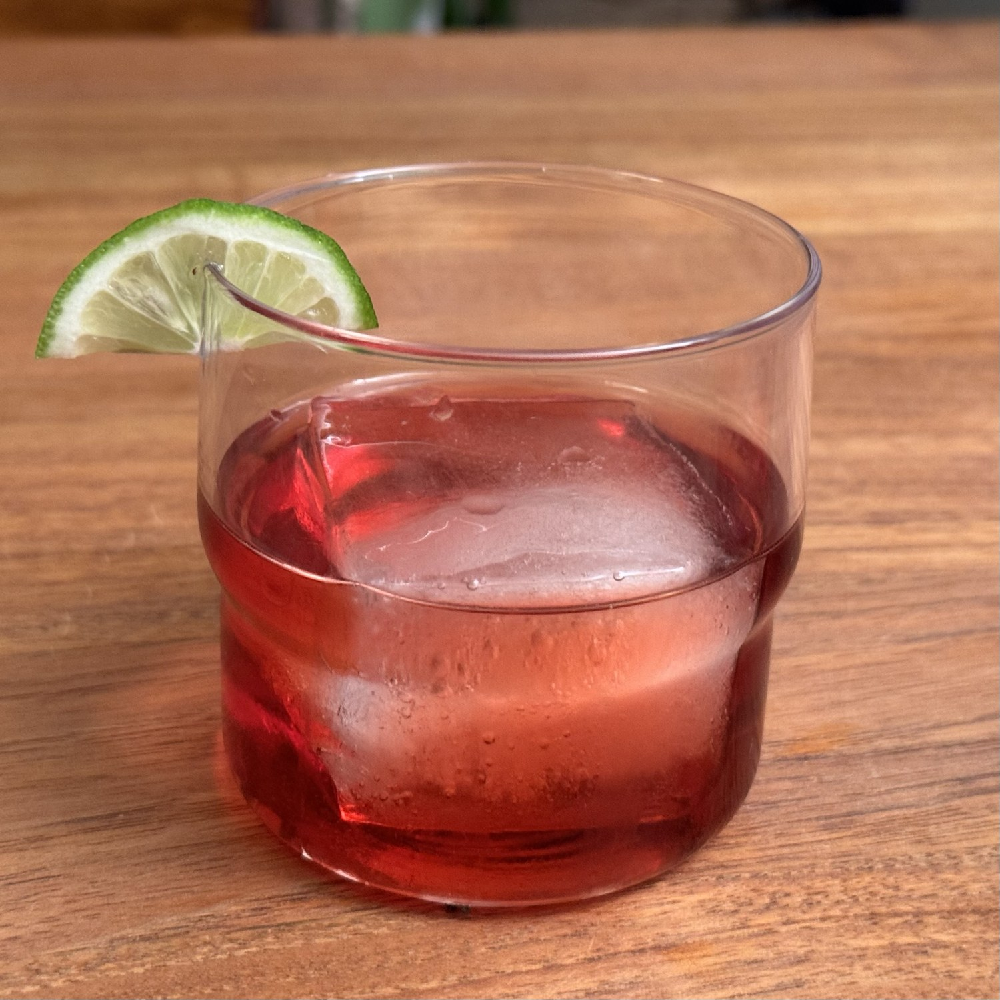

**1 porzione**.

## 🧾 Ingredienti

- 30 ml Gin
- 30 ml Bitter rosso, tipo Campari
- 30 ml Vermouth rosso dolce
- 1 cubo grande di ghiaccio, oppure ghiaccio a cubetti
- 1 scorza d'arancia o di lime per guarnire

## 👩‍🍳 Preparazione

1. Raffreddare un bicchiere **old fashioned**.
2. Versare gin, bitter e vermouth in un mixing glass colmo di ghiaccio.
3. Mescolare con un bar spoon per circa 20 secondi, finché il cocktail è freddo e leggermente diluito.
4. Filtrare nel bicchiere sopra un cubo grande di ghiaccio fresco.
5. Spremere la scorza d'arancia o di lime sulla superficie per liberarne gli oli, passarla sul bordo del bicchiere e usarla come guarnizione.

## 💡 Consigli

La proporzione classica è **1:1:1**. Non shakerare: la miscelazione mantiene il drink limpido.

Per una variante più aromatica, battere delicatamente tra i palmi una foglia di basilico o un piccolo rametto di rosmarino e usarlo come seconda guarnizione. Non immergerlo a lungo.
