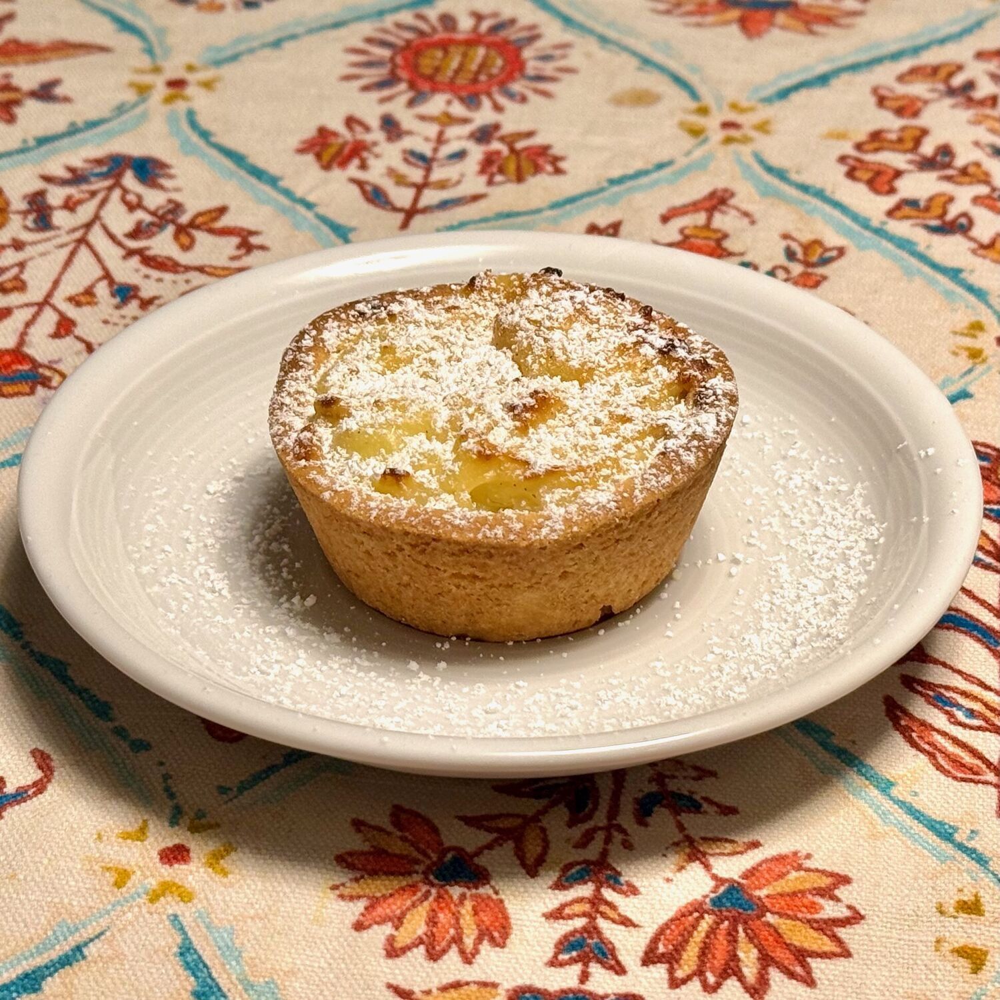

## 🧾 Ingredienti

- [Pasta Frolla](../Basi/Pasta frolla)
- [Crema pasticcera](../Basi/Crema pasticcera) o [Crema pasticcera Bimby](../Basi/Crema pasticcera Bimby) (dose ridotta, 300 ml di latte)

**Riso al latte**

- 150 g Riso (da risotto)
- 600 g Latte
- 60 g Zucchero semolato (ridotto rispetto all'originale)
- 1/2 Baccello di vaniglia
- Scorza grattugiata di 1/2 limone
- Un pizzico di sale
- Burro
- Zucchero a velo

## 👩‍🍳 Preparazione

1. Preparare per prima la [pasta frolla](../Basi/Pasta%20frolla.md) e riporla in frigo

**Preparazione del riso al latte**

2. Unire tutti gli ingredienti a parte il riso e riscaldare.
3. Lessare il riso nel latte per 20' mescolando spesso.
4. Mantecate con poco burro a fuoco spento e lasciate raffreddare

5. Preparate la [crema pasticcera](../Basi/Crema%20pasticcera%20Bimby.md) (dose ridotta, 300 ml di latte)

**Preparare i budini di riso**

6. Stendere la pasta frolla, e ritagliare 10-12 dischi da circa 9-10cm.
7. Adagiate i dischi infarinati in uno stampo da muffin per formare delle vaschette con le dita
8. Mescolate riso e crema non piu' caldi
9. Riempite i gusci di pasta frolla
10. Infornate a 160º (ventilato) per circa 35'

Servire tiepidi e spolverizzati di zucchero a velo
