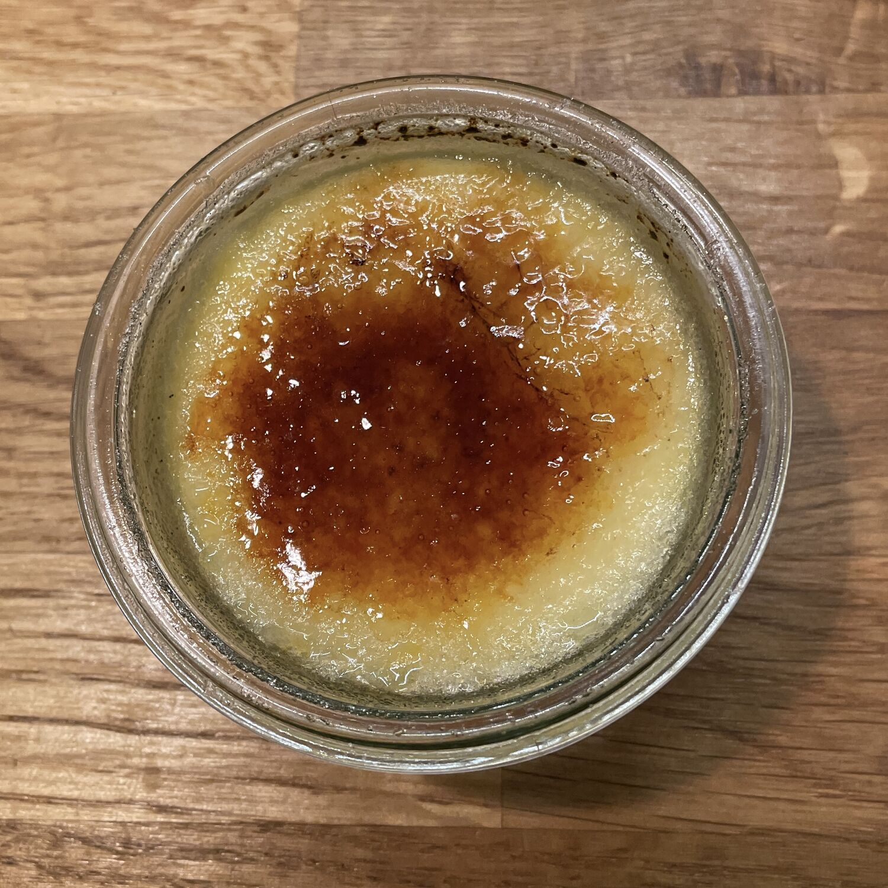
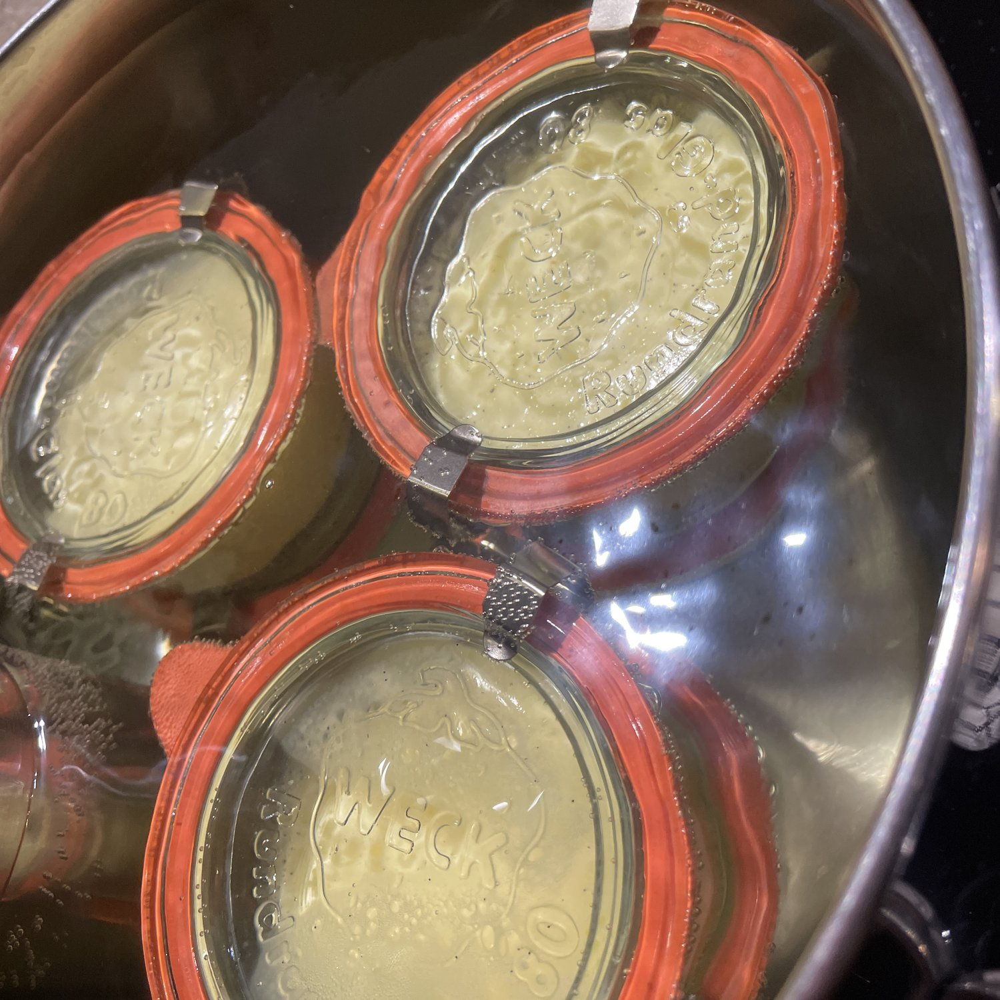

## 🧾 Ingredienti

**Crème**

- 9 Tuorli
- 90 g Zucchero
- 3 g Sale
- 600 g Panna

**Brûlée**

- Zucchero
- Cannello da cucina a gas

## 👩‍🍳 Preparazione

1. Riscaldare un contenitore capiente pieno d’acqua a 80° con il riscaldatore sous-vide.
2. Mescolare i tuorli con lo zucchero e il sale.
3. Aggiungere la panna liquida e mescolare senza incorporare aria.
4. Dividere in contenitori richiudibili in 5 o 6 porzioni da 150g circa (eg Weck Gourmet Jars 165 ml Jars RR80 with Glass Lid).

5. Se si sono formate bolle in superficie, scoppiarle con il bruciatore.
6. Chiudere i barattoli senza stringere troppo.
7. Immergere nel bagno a 80° per un’ora.
8. Raffreddare in acqua fredda e conservare in frigo per massimo una settimana.
9. All’uso cospargere di zucchero e caramellarlo con il bruciatore.

## 💡 Consigli

Non dirigere il bruciatore verso il bordo del barattolo, il vetro potrebbe rompersi per il calore.
