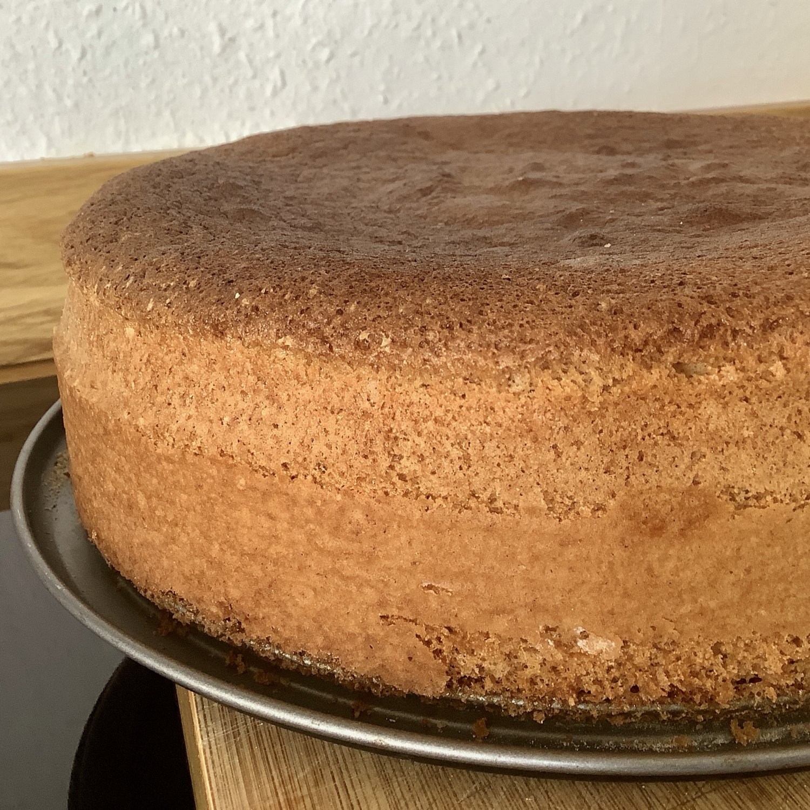

La ricetta originale di Nonna Paola

## 🧾 Ingredienti

- 8 uova
- 260 g Zucchero
- 200 g Farina 00
- 1/2 Bustina di lievito per dolci

## 👩‍🍳 Preparazione

1. Montare gli albumi a neve fino a che non sono in grado di tenere dritta in piedi una forchetta
2. Montare i tuorli con lo zucchero almeno fino a che non cambiano colore e diventano chiari
3. Aggiungere ai tuorli il lievito, la farina e gli albumi a neve poco a poco, mescolando con un cucchiaio di legno dal basso verso l'alto (senza smontare i bianchi)
4. Inserire in una teglia da 20 cm opportunamente imburrata e infarinata
5. Infornare a 170° per circa 50' (verificare con uno stecchino che non sia bagnato al centro)

## 💡 Consigli

- Per farcire: [crema pasticcera](../Basi/Crema%20pasticcera%20Bimby.md) con 800 ml - 1 l di latte.
- Se i bianchi sono ben montati e lo zabaione ben fatto, il lievito serve solo per scaramanzia :)
