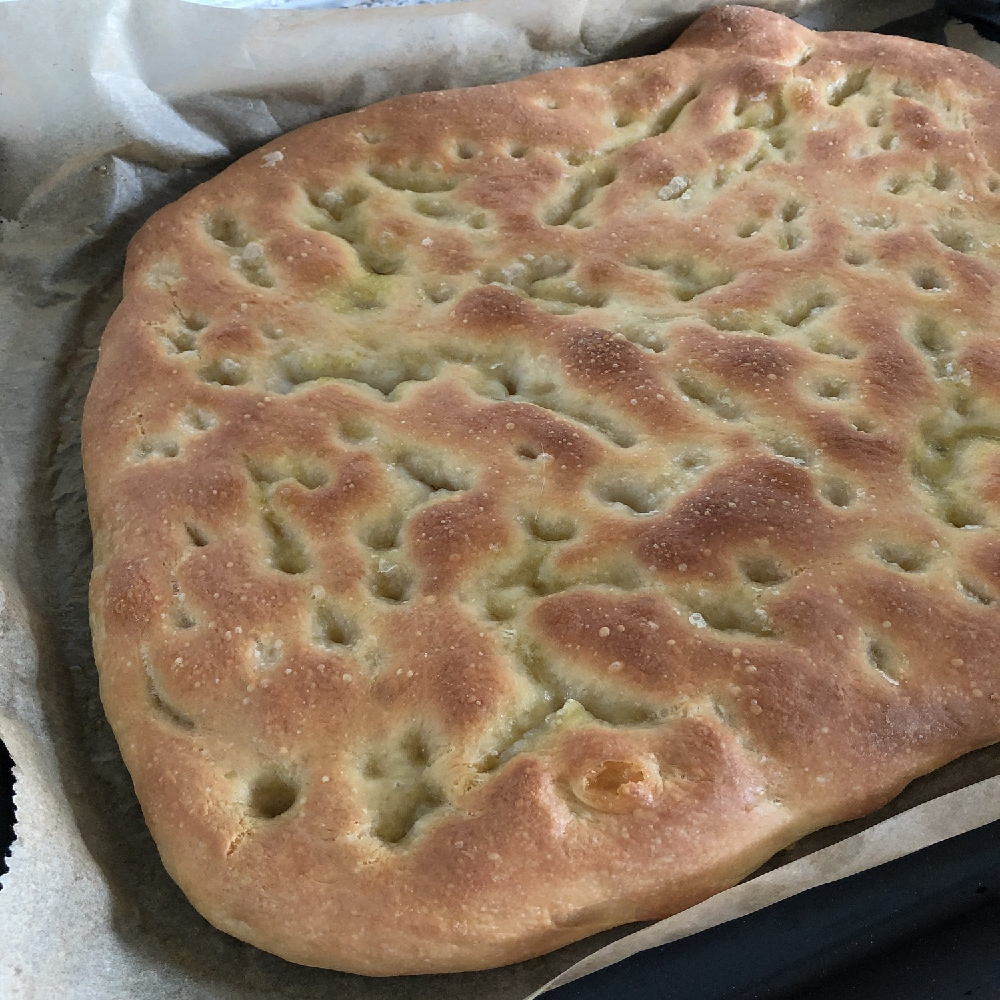

Per una leccarda da forno standard.

## 🧾 Ingredienti

- 500 g di farina per pizza
- 400 g d'acqua
- 5 g di lievito di birra
- 10 g miele
- 10 g di sale
- 50 g olio extravergine d'oliva

Per l'emulsione:

- 25 g Acqua
- 35 g Olio
- 7 g Sale

## 👩‍🍳 Preparazione

1. In una ciotola, sciogli il lievito di birra con un po' d'acqua a temperatura ambiente
2. Unisci alla restante acqua nel boccale del Bimby, 36 gradi, velocita' 1 per 1 minuto
3. Aggiungi la farina e il miele, velocita' 4 per 2 minuti
4. Aggiungi olio e sale, velocita' 4 per 2 minuti
5. Scodella l' impasto in una ciotola oliata e copri tenendo o in frigo tutta la notte o in caldo fino al raddoppio di volume
6. Trasferisci l'impasto al centro di una leccarda unta, o foderata con carta da forno, e stenderlo delicatamente con le dita fino a coprire tutta la superficie.
7. Copri con un telo umido e lascia lievitare circa 30 minuti
8. Accendi il forno a 200 gradi ventilato e vapore
9. Prepara l'emulsione con un minipimer o frullatore e versala sulla focaccia lievitata
10. Con le mani aperte ed usando tutte le dita premi sull'impasto per allargarlo e distribuire l'emulsione e creare dei saporitissimi buchetti. Non esagerare, ma sii deciso. Crea una superficie di avvallamenti uniforme.
11. Inforna per circa 20-25 minuti o fino al colore desiderato
12. Con un pennello da cucina, una volta sfornata, ridistribuire l'emulsione su tutta la superficie.
