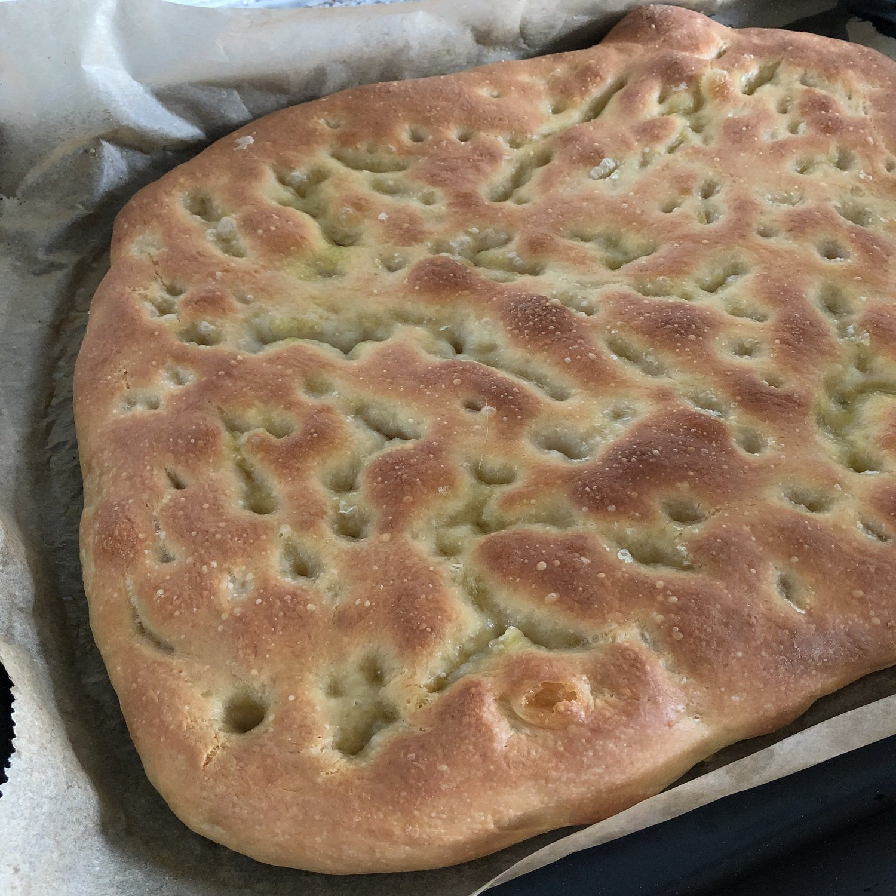

Per una leccarda da forno standard.

## 🧾 Ingredienti

- 500 g di farina per pizza
- 400 g d'acqua
- 5 g di lievito di birra
- 10 g di sale
- 50 g olio extravergine d'oliva
- Olio extravergine d'oliva q.b. per la ciotola, la teglia e la superficie
- Rosmarino e sale grosso (facoltativi)

## 👩‍🍳 Preparazione

1. In una ciotola, sciogliere il lievito di birra nell'acqua tiepida.
2. Aggiungere la farina gradualmente, mescolando con un cucchiaio di legno o con le mani.
3. Quando l'impasto inizia a prendere forma, aggiungere il sale e continuare a impastare fino a ottenere un composto liscio e omogeneo (circa 10 minuti).
4. Aggiungere l'olio e impastare ancora finché non è completamente assorbito.
5. Formare una palla, trasferirla in una ciotola leggermente unta, coprire con pellicola trasparente e lasciare lievitare in luogo caldo per circa 1-2 ore, o finché non raddoppia di volume.
6. Trasferire l'impasto nella leccarda unta, o foderata con carta forno unta, e stenderlo delicatamente con le dita fino a coprire tutta la superficie.
7. Coprire nuovamente e lasciare lievitare per altri 30-45 minuti.
8. Prima di infornare, creare dei piccoli avvallamenti sulla superficie con le dita e versare un filo d'olio extravergine d'oliva, eventualmente aggiungere rosmarino o sale grosso.
9. Infornare in forno preriscaldato a 220°C per circa 20-25 minuti, finché la superficie è dorata e croccante.
10. Sfornare, lasciare intiepidire leggermente e servire.

## 💡 Consigli

- Per una focaccia più soffice, aumentare leggermente l'idratazione (acqua) fino a 450 g.
- Si possono aggiungere olive, pomodorini, cipolle o altri ingredienti sulla superficie prima della seconda lievitazione.
- Conservare in un sacchetto di carta per mantenere la croccantezza.
