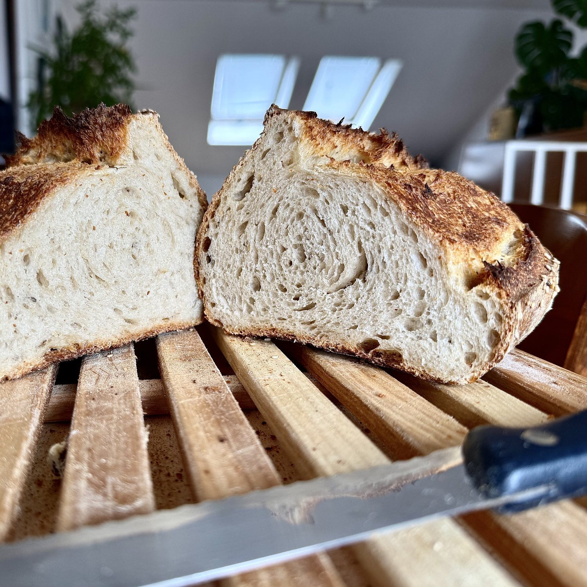

## 🧾 Ingredienti

- 800g farina tipo 0 forte (o circa 2/3 tipo 0 e 1/3 Manitoba)
- 480ml acqua (possibile sostituire fino al 50% con bianco d'uovo)
- 10g sale
- 200g lievito madre
- Semi di sesamo (facoltativi)

## 👩‍🍳 Preparazione

1. Impastare nell'impastatrice con gancio per 6-10 minuti, se avete un termometro: fino a che non raggiunge i 24 gradi
2. dopo 10' fare il primo stretch&fold (tirare la pasta dagli angoli fino a stenderla e poi ripiegarla su se stessa a fare una palla)
3. dopo 10' fare il secondo stretch&fold
4. dopo 10' fare il terzo stretch&fold
5. mettere in un recipiente graduato (fino a 2l) e lasciare lievitare fino a 1.7x (1700ml circa) per una temperatura dell'impasto intorno ai 23 gradi. Per temperature piu' basse arrivare anche a 2x, e per temperature piu' alte a 1.5x o anche meno.
6. porzionare in due pagnotte, dargli una forma rotonda, tendendo la superficie.
7. girare le palline di impasto a testa sotto e stendere le due meta', quindi arrotolarle strette, e chiuderle sotto e ai lati, facendo attenzione a non rovinare la superficie (usare pochissima farina sul piano)
8. mettere in un contenitore apposito con la cucitura in alto (se lo avete, oppure sul piano con la cucitura in basso) e coprire con un panno umido.
9. controllare dopo 45 minuti e fino a circa un'ora e mezza con il dito se la lievitazione e' a un buon punto (ci vorranno un po' di prove prima di capire il metodo)
10. inumidire la parte superiore e cospargere di semi di sesamo
11. fare un taglio (lungo tre lati, un po' sopra la meta')
12. infornare per 20' a 230 gradi con il vapore o nel Dutch oven gia' caldo
13. abbassare la temperatura a 200 gradi (togliere il coperchio se si e' usato il Dutch oven) e continuare a cuocere per altri 20'-25'
