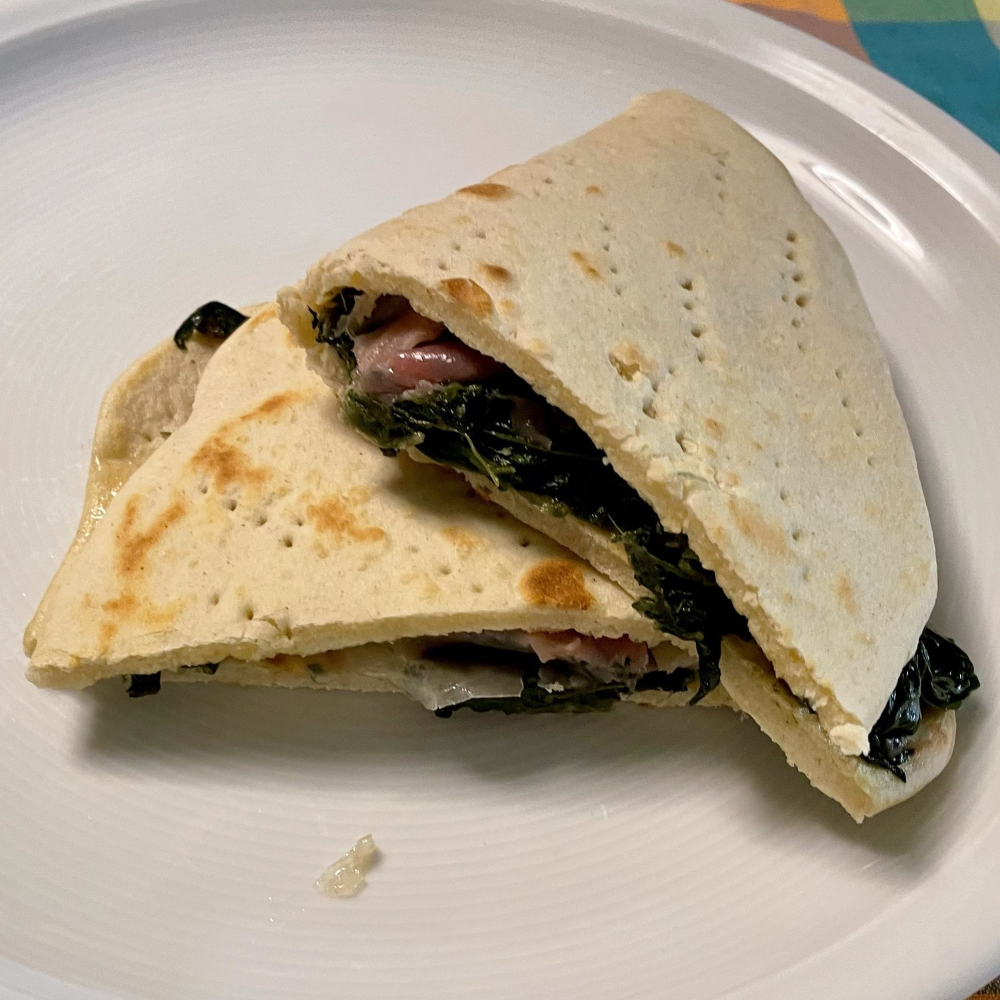
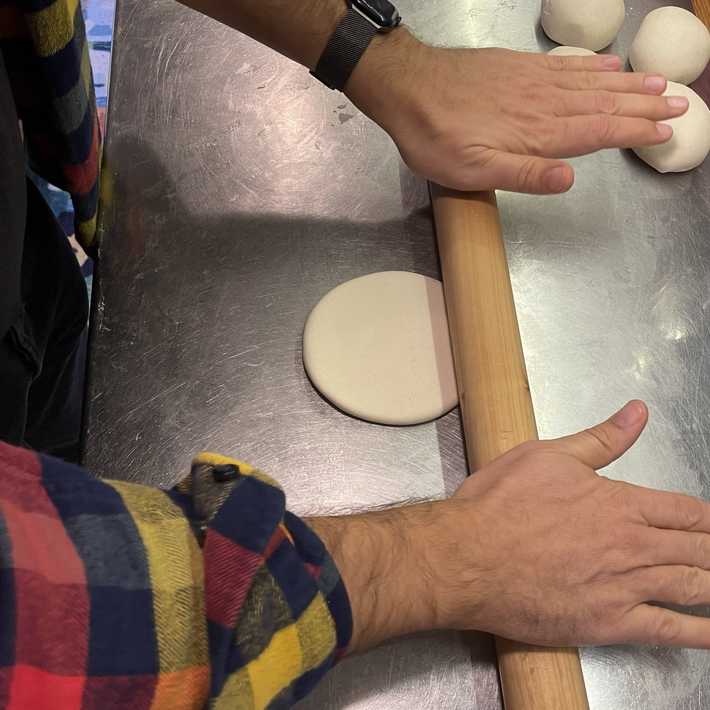
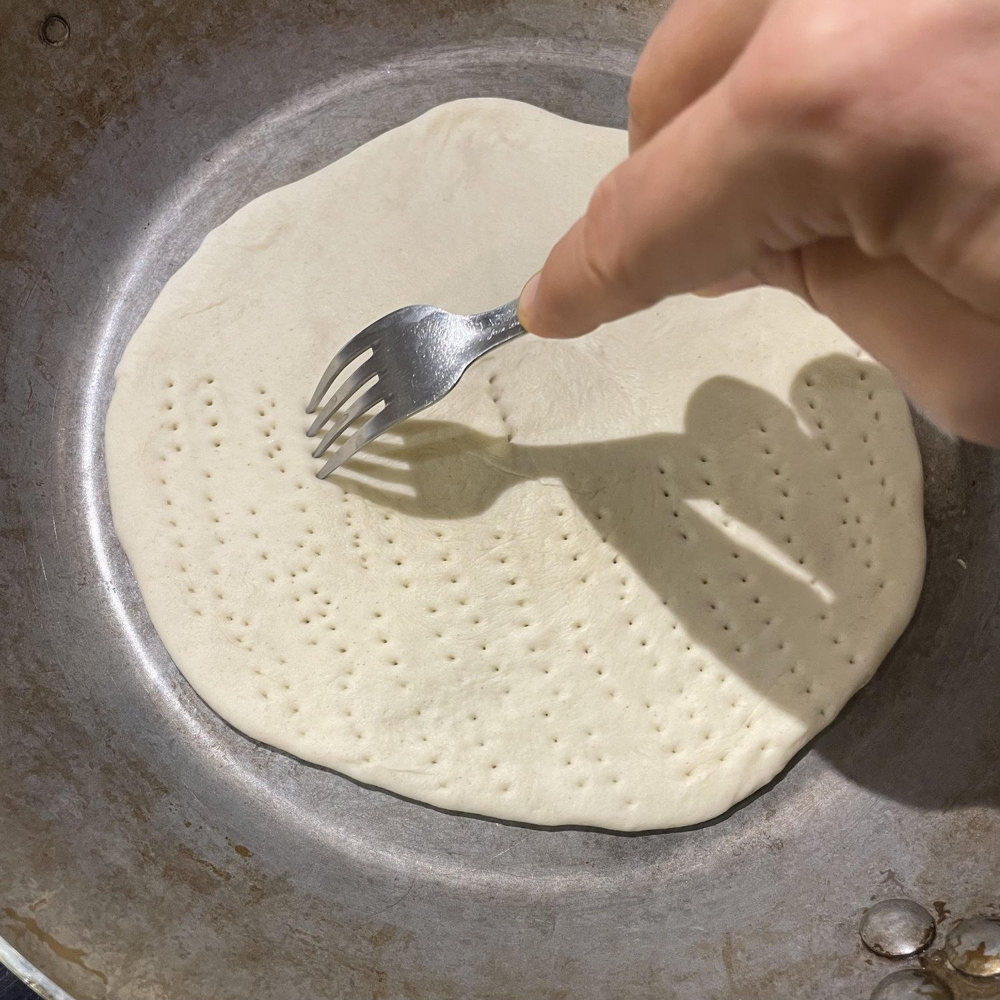

## 🧾 Ingredienti

- Dose per 6 piadine
- 500 g di farina 0
- 250 g di acqua tiepida
- 60 g di strutto
- 6-10 g di sale, a seconda dei gusti
- 1 pizzico di bicarbonato

## 👩‍🍳 Preparazione

1. Mescolare i solidi, aggiungere l'acqua e impastare fino ad ottenere un impasto omogeneo e non appiccicoso.
2. Lasciare riposare una mezz'ora a temperatura ambiente, coperto.
3. Fare 6 palline di peso uguale.
4. Stendere con un mattarello allo spessore desiderato (2-4 mm) e cuocere una ad una su una padella o piastra dal fondo spesso (meglio di ghisa o ferro, che tiene il calore). Punzecchiare la superficie della piadina con una forchetta appena messa a cuocere. Cuocere ogni piadina fino a raggiungere il colore desiderato, e poi girarla e cuocerla dall'altro lato. Iniziare a condirla direttamente sulla piastra.

## 💡 Consigli

Per una versione classica condire con stracchino, verdure di campo e prosciutto. Meglio se lo stracchino non è freddo di frigo.

Altri condimenti da provare, a piacere:

- stracchino o mozzarella, rucola e pomodorini
- stracchino, affettati vari e rucola
- stracchino, salmone e insalata iceberg
- squacquerone e fichi caramellati, con mandorle tostate a piacere
- mortadella, stracchino e granella di pistacchi
- porchetta, cipolla caramellata e squacquerone
- speck, gorgonzola e radicchio
