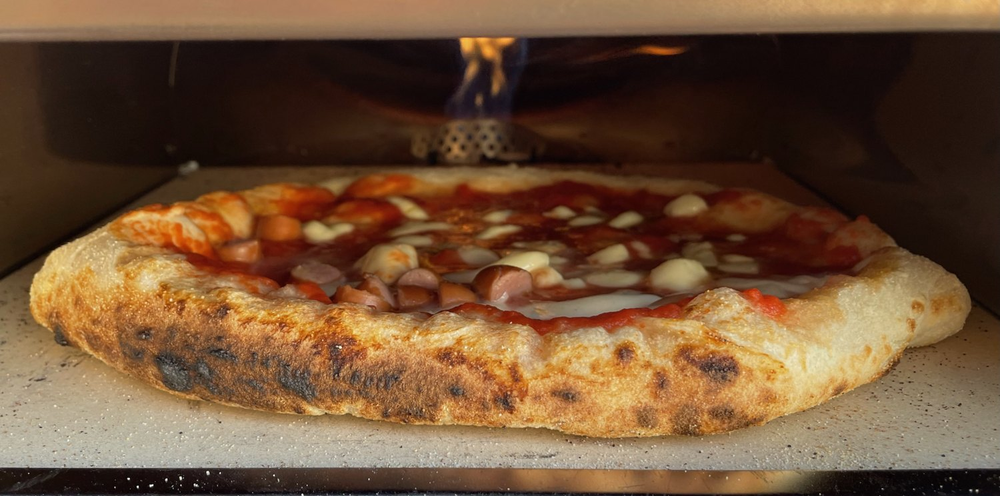

## 🧾 Ingredienti

- 2 Servings
- 350 g Farina manitoba (Farina forte con almeno 12 o 13g di proteine per 100g)
- 210 ml Acqua (60% idratazione)
- 7 g Sale fino
- 3 g Lievito di birra

## 👩‍🍳 Preparazione

1. Per cuocere la pizza a pranzo iniziare l'impasto verso le 11 del mattino **del giorno precedente**, per la sera, iniziare alle 18 del giorno precedente
2. Mettere tutti gli ingredienti nella planetaria e mescolare per almeno 5-6 minuti
3. Trasferire sul piano di lavoro e lavorare un altro minuto per avere un impasto liscio
4. Formare una palla, metterla in una ciotola leggermente unta e lasciare riposare per 10 minuti
5. Fare 3 set completi di stretch & fold a distanza di 10 minuti
6. Mettere l'impasto nella ciotola a riposare per 10 minuti
7. Dividere l'impasto in 2 palline uguali di circa 285 grammi. Sigillare le palline tirando l'impasto verso il basso in modo che sia ben teso
8. Mettere in un contenitore che permetta alle palline di lievitare senza toccarsi.
9. Lasciare fermentare in frigo per 24 ore
10. Tirare fuori le palline 3-4 ore prima di usarle
11. Infornare nel forno di casa su una leccarda calda o in un forno da pizza (e.g. Roccbox) dopo aver steso e condito a piacere.

Nel Roccbox: 400-450° per circa 90", girando la pizza di 90° ogni 25".
