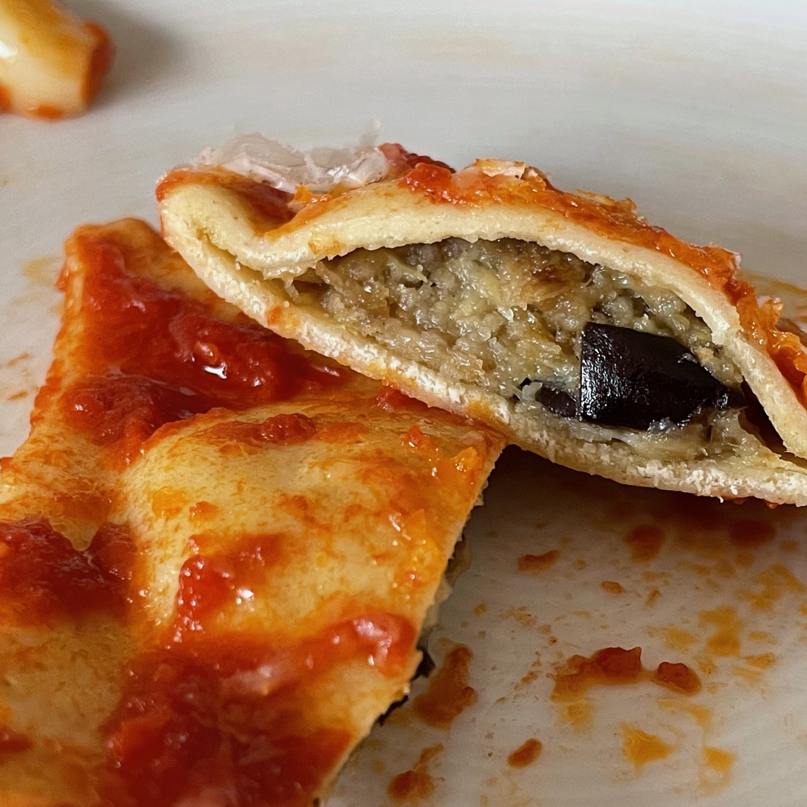

## 🧾 Ingredienti

- Dose per 2 persone

**Ripieno**

- 100 g Melanzana a cubetti saltata croccante
- 3 Mozzarelline
- 3 cubetti di auricchio o provola
- Olio
- Sale
- Peperoncino
- Aglio
- Parmigiano e pangrattato per amalgamare

**Impasto**

- [Pasta all'uovo](../Basi/Pasta%20all'uovo.md) con 1 Uovo e 1 Tuorlo

**Sugo**

- Harissa
- Aglio
- Concentrato di pomodoro
- Poca passata di pomodoro
- Olio abbondante

## 👩‍🍳 Preparazione

1. Impastare gli ingredienti del ripieno ancora tiepidi.
2. Riempire i ravioli
3. Preparare il sugo facendo stringere un po' il sugo per insaporire
4. Cuocere, scolare, saltare e servire!
