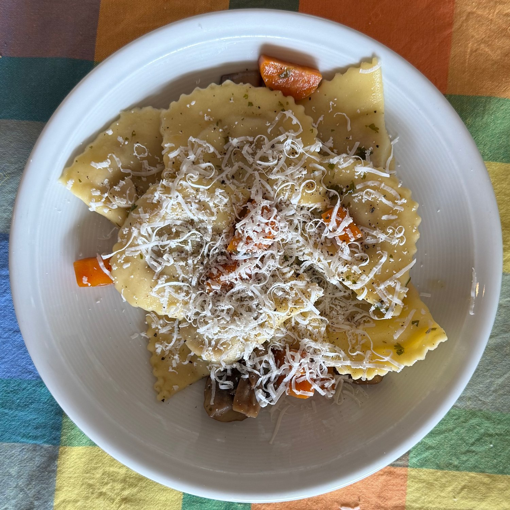
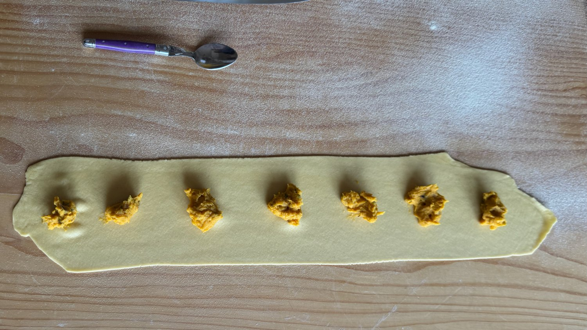
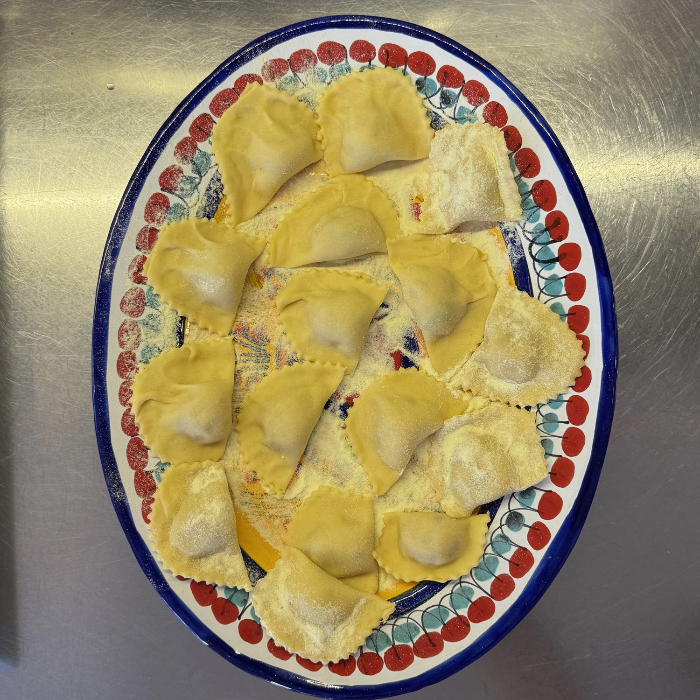

## 🧾 Ingredienti

- Dose per 6 persone

**Ripieno**

- 500 g Zucca butternut (o Hokkaido)
- 2 cm Zenzero
- Noce moscata
- Cannella
- Rosmarino
- 1 Cipolla rossa piccola
- Mascobado
- 50 g ricotta salata
- Sale

**Impasto**

- 4 Uova
- 400 g Farina di semola (o mista)

## 👩‍🍳 Preparazione

1. Cuocere in forno zucca e cipolla a 160° ventilato per 20 - 40 minuti (fino a che sia la zucca che le fette di cipolla non sono facili da spappolare con una forchetta)
   - Le cipolle a fette cosparse di zucchero mascobado
   - La zucca a fette
2. Tritare il rosmarino
3. Grattugiare lo zenzero
4. Grattugiare la ricotta salata
5. Mescolare gli ingredienti del ripieno

6. Distribuire il ripieno sulla sfoglia

7. Chiudere i ravioli con le mani e ritagliarli

8. Cuocere e condire con sugo a piacere!

## 💡 Consigli

Nella foto i ravioli sono stati conditi con funghi e carote [sous-vide](../Basi/Sous Vide.md).
Metti in una busta funghi in quarti, carote a tocchetti, olio, aglio, sale, pepe, e aromi (prezzemolo. come stara' con la salvia?) e cuoci a 80° per un'ora o due.

Ottimi anche con burro e amaretti sbriciolati.

L’amico Nanni suggerisce la Zucca di tipo Delica .
