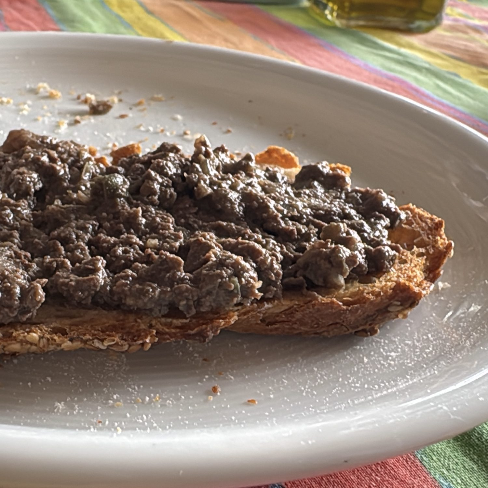

Il crostino nero toscano di Manu.

## 🧾 Ingredienti

- 400 g Fegatini di pollo puliti
- 1 Cipolla
- 1 spicchio d'Aglio
- 2 Acciughe
- Salvia
- Olio
- 1/2 bicchiere (100 ml) di brodo, vino o acqua
- Capperi (facoltativi)
- Pane toscano tostato

## 👩‍🍳 Preparazione

1. Soffriggere in olio le acciughe, la cipolla tritata, l'aglio e la salvia a fuoco basso
2. Aggiungere i fegatini e bagnare con il brodo, vino o acqua (aggiungerne un goccio se si asciuga)
3. Cuocere a fuoco lento 10-20' finché non si sfaldano, non di più altrimenti diventano stopposi
4. Aggiungere i capperi e schiacciare con una forchetta (o un colpo di Minipimer)
5. Spalmare sul pane tostato

## 💡 Consigli

Volendo, bagnare velocemente il pane nel brodo caldo prima di spalmare.
