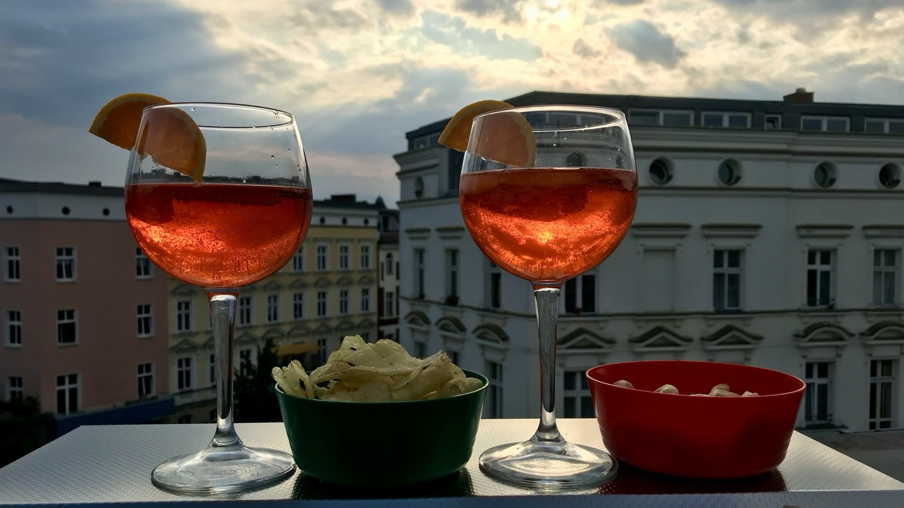

# Le ricette di Daniela e Mirko

## Chi siamo

{ .chi-siamo width="112" height="112" }
Le Ricette di Daniela e Mirko, una famiglia italiana a Berlino.

Potete scriverci a `mirko (at) maischberger.it`

## Dalla nostra cucina

- [Pasta all’uovo](Basi/Pasta%20all'uovo.md)
- [Pizza](Pane%20e%20pizza/Pizza.md)
- [Curry di pollo con il Bimby](Secondi/Curry.md)
- [Torta di mele](Dolci/Torta%20di%20Mele.md)

## Intelligenza artificiale e autenticità delle foto

Questo sito è mantenuto con il supporto di diversi modelli di intelligenza artificiale, sia locali sia basati sul cloud. Ad eccezione della nostra foto qui sopra, tutte le immagini mostrano ricette autentiche preparate nella nostra cucina e rappresentano fedelmente le ricette descritte.
